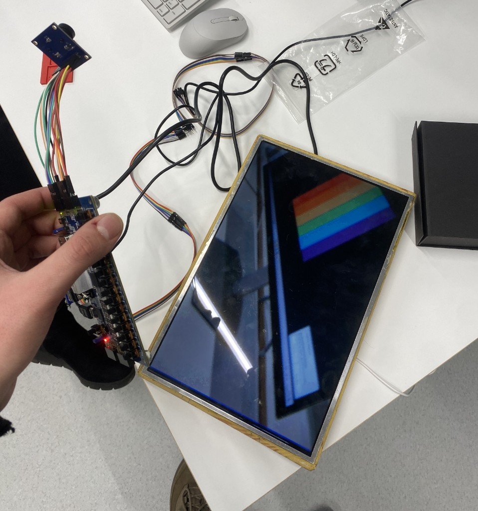
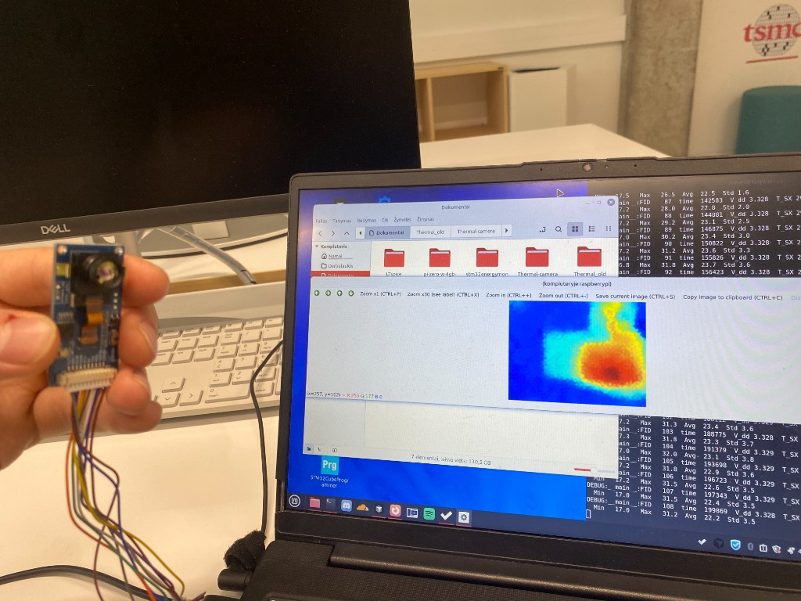

# Thermal Camera

## Project Status

The OV7670 optical camera is now working directly on the FPGA.

The thermal camera is currently working through a Raspberry Pi using Python.

The next steps are to transfer the thermal camera implementation from Python to Verilog on the FPGA and then fuse the optical and thermal camera outputs.